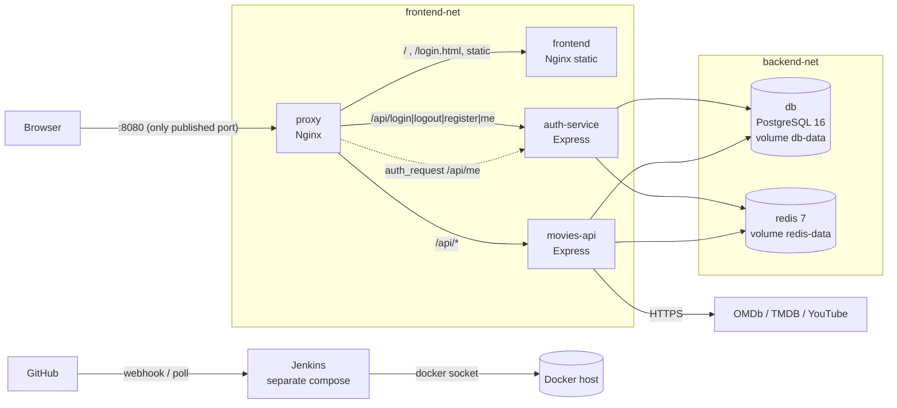

# CineList Architecture

## Request flow

| Request | Path |
|---|---|
| Open the app (`/`) | proxy asks auth-service `/api/me` (internal `auth_request`). 200 → frontend `index.html`; 401 → redirect to `/login.html` |
| Log in / register / log out | proxy → auth-service → `users` table; session stored in Redis |
| Watchlist, search, trailers, featured | proxy → movies-api (reads the shared Redis session) → Postgres / OMDb / TMDB |
| Health (smoke test) | proxy `/health/auth` and `/health/movies` → each service's `/health` (which also pings the DB) |

## Networks, ports, volumes

| Item | Detail |
|---|---|
| `frontend-net` | proxy, frontend, auth-service, movies-api |
| `backend-net` | auth-service, movies-api, db, redis (db and redis are unreachable from proxy/frontend) |
| Published ports | **8080 → proxy only**. Postgres, Redis and the APIs are never published |
| `db-data` | PostgreSQL data (users, watchlists, featured picks) |
| `redis-data` | Redis AOF file, so logins survive redeploys |
| Jenkins | Separate compose in `infra/jenkins`, volume `jenkins_home`, UI on 8081 |

## Why these choices

| Choice | Reason |
|---|---|
| Nginx (unprivileged image) | Single entry point, path routing, `auth_request` gate, runs as non-root |
| Express (Node 20) | Existing app code was already Express; split into two small services |
| PostgreSQL 16 | Relational data (users → movies) with real constraints and a named volume |
| Redis 7 | Shared session store so two services see the same login, survives redeploys |
| `node --test` | Built into Node, so no extra test dependencies in the images |
| Jenkins + Docker socket | Required by the course; see the security note in the README |
